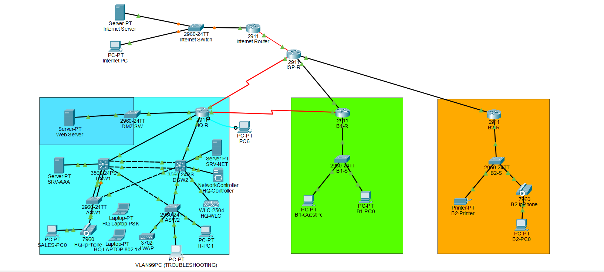
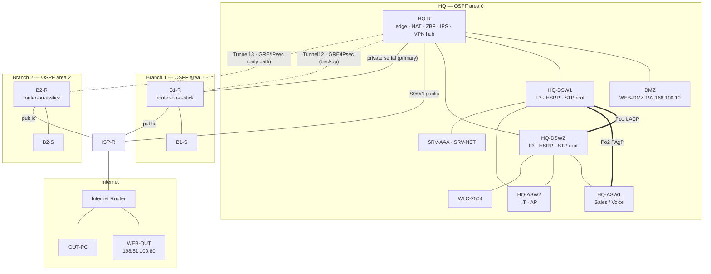

# CCNA + Network Security Mega Lab

A multi-site enterprise network built from scratch in Cisco Packet Tracer: a redundant HQ campus, two branches, a DMZ, an ISP and an "internet", covering every hands-on CCNA v1.1 topic plus a layer of network security on top (AAA, 802.1X, site-to-site IPsec VPN, a zone-based firewall and an IPS).

The network was built in eleven phases, each one verified and then deliberately broken and fixed. The full build took about ten days.

| | |
|---|---|
| **Sites** | HQ (redundant 3-tier campus + DMZ), Branch 1, Branch 2, ISP, internet |
| **Devices** | 4 routers (2911), 2 L3 switches (3560), 5 access switches (2960), WLC + lightweight AP, network controller, 4 servers, PCs, IP phones, laptops |
| **Routing** | Multi-area OSPFv2 with MD5 auth and summarisation, floating static routes, IPv6 dual stack |
| **Security** | AAA (TACACS+ / RADIUS), 802.1X, ACLs, port security, DHCP snooping, DAI, GRE over IPsec, zone-based firewall, IOS IPS |

---

## Topology

**Logical overview:**

**Design in one paragraph:** HQ-R is the single security edge — every path between sites and to the internet crosses it. HQ has a redundant distribution layer (two L3 switches running HSRP, EtherChannel between them and to the access layer). Branch 1 reaches HQ over a private serial link, with an encrypted GRE/IPsec tunnel through the ISP as automatic backup. Branch 2 has no private link and reaches HQ only through its VPN tunnel, while breaking out to the internet locally.

---

## Addressing

**HQ VLANs** (gateway `.1` is the HSRP virtual IP; DSW1 `.2`, DSW2 `.3`)

| VLAN | Name | Subnet | Notes |
|---|---|---|---|
| 10 | SALES | 10.10.10.0/24 | + IPv6 2001:db8:acad:10::/64 (SLAAC) |
| 20 | IT | 10.10.20.0/24 | |
| 30 | VOICE | 10.10.30.0/24 | voice VLAN for the IP phones |
| 40 | WIFI | 10.10.40.0/24 | wireless clients |
| 50 | SERVERS | 10.10.50.0/24 | SRV-AAA .10, SRV-NET .11 |
| 99 | MGMT | 10.10.99.0/24 | switch SVIs, WLC .5, controller .10 |
| 999 | NATIVE | — | unused native VLAN on every trunk |
| 666 | PARKING | — | every unused access port (shut down) |

**Branches** (VLSM, largest subnet first)

| Site | VLAN | Subnet | Gateway |
|---|---|---|---|
| Branch 1 (10.20.0.0/22) | 110 Users | 10.20.0.0/24 | 10.20.0.1 |
| | 120 Guest | 10.20.1.0/26 | 10.20.1.1 |
| | 199 Mgmt | 10.20.1.64/28 | 10.20.1.65 |
| Branch 2 (10.30.0.0/23) | 210 Users | 10.30.0.0/25 | 10.30.0.1 |
| | 220 Printers | 10.30.0.128/27 | 10.30.0.129 |
| | 299 Mgmt | 10.30.0.160/28 | 10.30.0.161 |

**Links, tunnels, loopbacks**

| Link | Subnet |
|---|---|
| HQ-R ↔ DSW1 / DSW2 | 10.0.0.0/30, 10.0.0.4/30 |
| HQ-R ↔ B1-R (private serial) | 10.0.0.8/30 |
| Tunnel12 (HQ ↔ B1) / Tunnel13 (HQ ↔ B2) | 172.16.12.0/30, 172.16.13.0/30 |
| DMZ | 192.168.100.0/24 |
| Public links to the ISP | 203.0.113.0/30, .4/30, .8/30 |
| Published DMZ server (static NAT) | 203.0.113.33 |
| Loopbacks / router IDs | 1.1.1.1, 2.2.2.2, 3.3.3.3, 11.11.11.11, 22.22.22.22 |

OSPF areas: **area 0** = HQ, **area 1** = Branch 1 (serial + Tunnel12), **area 2** = Branch 2 (Tunnel13). HQ-R is the only ABR.

---

## What was built, phase by phase

### 1 · Base configuration and device hardening
Hostnames, banners, `enable secret`, SSH v2 only (2048-bit RSA, local users), console and VTY timeouts, minimum password length, `login block-for` against brute force, privilege levels and role-based CLI views (parser views).

### 2 · Switching
VLANs and VTP-free trunking with a dedicated native VLAN (999), DTP disabled everywhere (`nonegotiate`). EtherChannel with **LACP** (DSW1 ↔ DSW2) and **PAgP** (DSW1 ↔ ASW1). **Rapid PVST+** with deterministic root placement per VLAN, **PortFast + BPDU guard** on edge ports, **root guard** on downlinks, loop guard on uplinks. Voice VLAN for IP phones, protected ports, unused ports shut down in a parking VLAN.

### 3 · Routing
SVIs with **HSRPv2** on both distribution switches, router-on-a-stick at the branches. **Multi-area OSPFv2**: point-to-point network types on routed links, passive interfaces toward users, **MD5 authentication**, inter-area **summarisation** (`area range`) at the ABR, a default route originated from the edge. **Floating static** default route on Branch 1 as an internet backup. **IPv6 dual stack** (static, EUI-64, SLAAC, link-locals, IPv6 default routes).

### 4 · IP services
Centralised **DHCP** with relay (`ip helper-address`) for every HQ VLAN, local DHCP pools on Branch 1. **PAT** for all internal users and **static NAT** publishing the DMZ web server. **NTP** with authentication, timestamps and a single time source. **DNS** with split-horizon records, **Syslog**, **SNMP**, and config/IOS backups to **TFTP/FTP**.

### 5 · ACLs and Layer 2 security
A written policy table first, then **named extended ACLs** enforcing it: Sales may only use DNS/DHCP/web on the servers, guests reach the internet only, Branch 2 printers are reachable only from Branch 2 and IT. Standard ACLs restricting **SSH to the management and IT subnets** (`access-class`). An **IPv6 ACL**. **Port security** (sticky, max 2 for phone + PC), **DHCP snooping** with rate limiting, **Dynamic ARP Inspection**, a VLAN-hopping audit.

### 6 · AAA
**TACACS+** for device administration on routers and L3 switches, **RADIUS** on the access switches, with local accounts as fallback and a local-only console list so a dead AAA server can never lock out the console. Authorisation and accounting. **802.1X** port authentication on an access port.

### 7 · Site-to-site VPN
**GRE over IPsec** from HQ to both branches: ISAKMP policy (AES-256, SHA, DH group 5, pre-shared keys), transform sets, crypto ACLs matching GRE between the public addresses, crypto maps on the public interfaces. OSPF runs over the tunnels — the backup tunnel to Branch 1 is made more expensive than the serial link so it only carries traffic on failure (verified with a failover test).

### 8 · Perimeter security
**Zone-based firewall** on HQ-R with INSIDE, DMZ and OUTSIDE zones: stateful inspection outbound, only web traffic inbound to the DMZ server, nothing inbound to the LAN. **IOS IPS** on the internet interface (signature-based, inline drop + alerts to Syslog). Control-plane policing designed (see limitations).

### 9 · Wireless
**WLC-2504** with a lightweight AP joining over **CAPWAP** (local mode, split MAC), AP discovery across subnets with **DHCP option 43**. Two WLANs: **WPA2-Personal** and **WPA2-Enterprise** authenticating users against RADIUS.

### 10 · Automation
A **network controller** discovering the devices, and a **Python** script using its **REST API** — POST for an auth ticket, GET for the device inventory — parsing the JSON response.

### 11 · Monitoring and security mapping
Central logging, and a **mitigation map** linking each common attack to the control in this network that stops it:

| Attack | OSI layer | Control in this lab |
|---|---|---|
| CAM table overflow | 2 | Port security |
| ARP spoofing / MITM | 2 | Dynamic ARP Inspection |
| Rogue DHCP server | 2 | DHCP snooping |
| DHCP starvation | 2 | DHCP snooping rate limiting |
| IP spoofing | 3 | IP Source Guard |
| VLAN hopping (switch spoofing) | 2 | Static access ports, DTP off |
| VLAN hopping (double tagging) | 2 | Dedicated unused native VLAN |
| Rogue switch / STP root takeover | 2 | Root guard, BPDU guard |
| OSPF route injection | 3 | OSPF authentication |
| SSH brute force | 7 | CoPP, strong SSH passwords |
| Ping flood to the router | 3 | IPS, CoPP |
| Eavesdropping on the WAN | 3 | IPsec |
| Unauthorised device on a wall port | 2 | Unused ports shut down |
| Inbound scan from the internet | 3–4 | Zone-based firewall |

---

## Troubleshooting

The most valuable part of the project was everything that didn't work the first time. **[troubleshooting.md](troubleshooting.md)** documents real problems from the build — and how each one was found — plus 24 break-fix scenarios worked through as trouble tickets (symptom → the command that pinpoints it → fix).

**[limitations.md](limitations.md)** lists what Packet Tracer couldn't simulate, with the configuration that would be used on real hardware.

---

## Try it yourself — lab credentials (demo only)

Open the `.pkt` file in Packet Tracer 8.x and log in with the credentials below. They exist only in this lab and are published on purpose so you can explore and break things yourself. The files in `configs/` stay redacted.

| Account | Username | Password |
|---|---|---|
| Local login (console, and SSH fallback) | `admin` | `<hostname>_Password` — e.g. `HQ-R_Password` |
| Enable secret | — | `<hostname>` — e.g. `HQ-R` |
| AAA login over SSH (TACACS+ / RADIUS) | `netadmin` | `netadmin` |

Hostnames: `HQ-R`, `B1-R`, `B2-R`, `ISP-R`, `Internet-R`, `HQ-DSW1`, `HQ-DSW2`, `HQ-ASW1`, `HQ-ASW2`, `B1-S`, `B2-S`, `DMZ-SW`, `Internet-SW`.

SSH logins go to the AAA server first (SRV-AAA, 10.10.50.10); the local `admin` account only works remotely when the server doesn't answer. Only the management (10.10.99.0/24) and IT (10.10.20.0/24) subnets may SSH in.

---

## Repository contents

| Path | Contents |
|---|---|
| `README.md` | this overview |
| `troubleshooting.md` | real issues from the build + 24 break-fix tickets |
| `limitations.md` | Packet Tracer gaps and the real-world equivalent |
| `configs/` | running configuration of every device (secrets removed) |
| `topology.png` | the topology as built in Packet Tracer |
| `Cisco CCNA Mega Lab.pkt` | the Packet Tracer file (Packet Tracer 8.x) |

---

*Built by Sam Brismo — IT security student (IT-säkerhetsspecialist, Teknikhögskolan Stockholm), preparing for the Cisco CCNA.*
